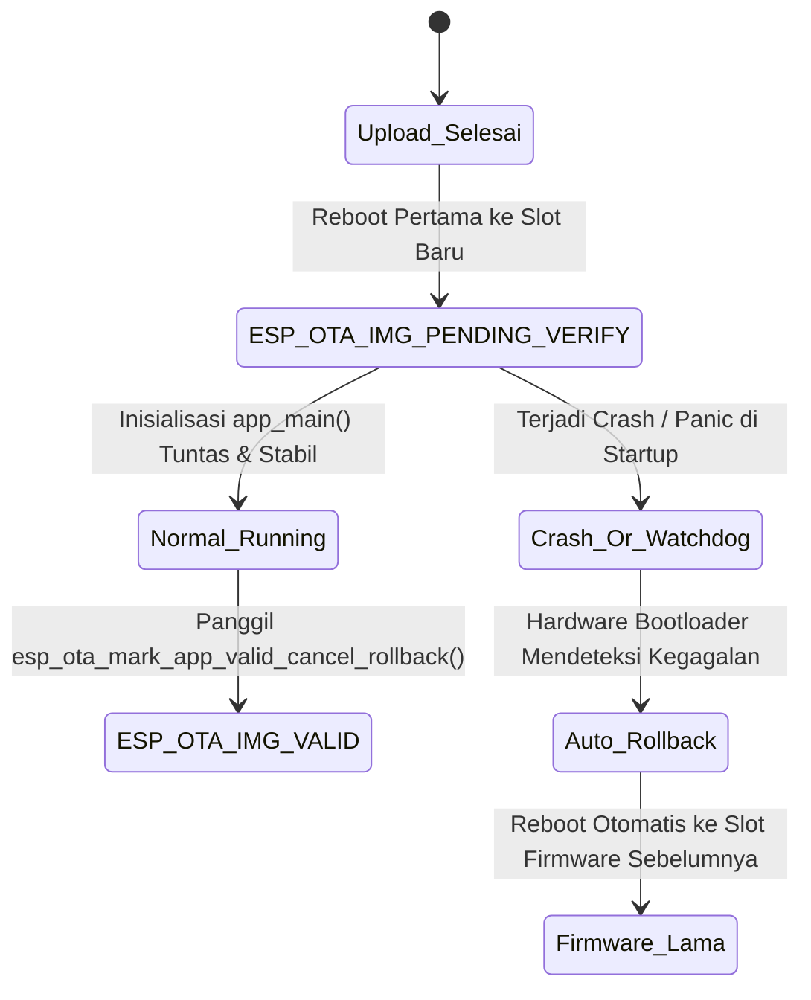

# Carrier-Grade Dual OTA Architecture - IOTARU SG-10

Dokumen ini menjelaskan arsitektur pembaruan firmware dan filesystem over-the-air (**Carrier-Grade Dual OTA**) berbasis **ESP-IDF Native**, validasi pre-flight signature, proteksi *anti-brick hardware rollback*, dan strategi *total data silencing* pada **IOTARU SG-10**.

---

## 1. Skema Partisi Dual OTA (A/B Switching)

Untuk memastikan gateway tidak pernah mengalami mati total (*hard-brick*) saat proses flashing terputus, gateway mengadopsi partisi dual-slot:

```
[4 MB SPI Flash Memory]
+---------------------------------------------------------------------------------------+
| 0x00000 | Bootloader (ROM)                                                            |
| 0x09000 | NVS Flash Partition (24 KB)                                                 |
| 0x0F000 | OTA Data Selection Partition (8 KB - otadata)                               |
| 0x11000 | PHY Calibration Data (4 KB - phy_init)                                      |
+---------+-----------------------------------------------------------------------------+
| 0x20000 | APP 0 Active Firmware Slot (1.43 MB / 1.464 KB)                             |
|         | -> Firmware Versi N berjalan di sini                                        |
+---------+-----------------------------------------------------------------------------+
| 0x190000| APP 1 Standby OTA Firmware Slot (1.43 MB / 1.464 KB)                          |
|         | -> Target penulisan firmware baru via OTA (Versi N+1)                       |
+---------+-----------------------------------------------------------------------------+
| 0x300000| Storage Partition (LittleFS Web UI - 1.00 MB / 1.024 KB)                     |
+---------------------------------------------------------------------------------------+
```

### Mekanisme Pergantian Partisi:
- Partisi `otadata` (0xF000) mencatat slot aktif dan nomor sequence bootloader.
- Saat pembaruan firmware diunggah via `/api/v1/ota/upload`, data dituliskan ke partisi cadangan yang sedang tidak aktif via `esp_ota_begin()` dan `esp_ota_write()`.
- Setelah transfer biner selesai 100% dan lolos kalkulasi checksum SHA-256, `esp_ota_set_boot_partition()` memperbarui penunjuk `otadata` ke slot baru.

---

## 2. Validasi Pre-Flight Signature & Hardware Identity

Sebelum biner dituliskan ke chip flash, server memeriksa byte pertama biner (`index == 0`) di sisi backend C++ [ota_service.cpp](file:///c:/Users/syafr/OneDrive/Documents/PlatformIO/Projects/esp32_ibeacon_espidf/src/web/ota_service.cpp) untuk mencegah salah pasang berkas:

```
Stream Upload Masuk (Chunk 0)
         |
         +---> Cek 1: Apakah berisi Magic Table Partisi 0x50AA?
         |            YA -> TOLAK SEKETIKA! (Mencegah partitions.bin merusak flash)
         |
         +---> Cek 2: Apakah berkas Firmware Aplikasi?
         |            - Byte 0x00 mutlak 0xE9 (ESP Image Magic)
         |            - Offset 0x20 mutlak 0xABCD5432 (esp_app_desc_t Magic)
         |            - Cek Identitas Hardware (Offset 0x50 project_name):
         |                Format: "MODEL@BOARD_VERSION" (misal: "SG-10@v1.0.0")
         |                Jika Model atau Board Version tidak cocok -> TOLAK!
         |
         +---> Cek 3: Apakah berkas Filesystem LittleFS?
                      - Tidak diawali 0xE9 atau 0x50AA
                      - Offset 0x08..0x0F memuat teks ASCII "littlefs"
                      - Ditulis langsung ke partisi 'storage' (0x300000)
```

---

## 3. Anti-Brick Hardware Rollback Silikon ESP-IDF

Gateway memanfaatkan fitur bawaan silikon ESP-IDF Bootloader Rollback (`CONFIG_BOOTLOADER_APP_ROLLBACK_ENABLE=y`):



> [!IMPORTANT]
> **Jaminan Keamanan**: Jika firmware baru mengalami crash/panic akibat bug kode atau hilangnya sinyal periferal sebelum `app_main()` tuntas, bootloader ESP32 secara otomatis membatalkan boot slot tersebut dan kembali ke firmware lama pada reboot berikutnya. Gateway **mustahil mengalami hard-brick di lapangan**.

---

## 4. Total Data Silencing Selama Flashing OTA

Untuk mencegah terjadinya benturan alokasi memori (*Out Of Memory*) atau saturasi soket TCP selama proses penulisan flash:
1. **Ingestion nRF Ditangguhkan**: Alokasi paket beacon ke antrean FreeRTOS distop; FIFO hardware UART di-drain cepat tanpa memory leak.
2. **Task MQTT Diistirahatkan**: Task MQTT Publisher di Core 1 ditunda (`vTaskDelay(200)`), mencegah transmisi paket data batch ke broker.
3. **Stream WebSocket Ditangguhkan**: Pengiriman array beacon JSON dihentikan sementara, menyisakan seluruh bandwidth jaringan untuk progress bar OTA (`ota_progress`).
4. **Indikator Visual**: LED SYS berganti ke warna **Oranye Kedip Cepat 10 Hz** (`SYS_LED_OTA`). Jika upload terputus atau gagal, status otomatis kembali ke **Hijau Normal** (`SYS_LED_NORMAL`) via `esp_ota_abort()`.
